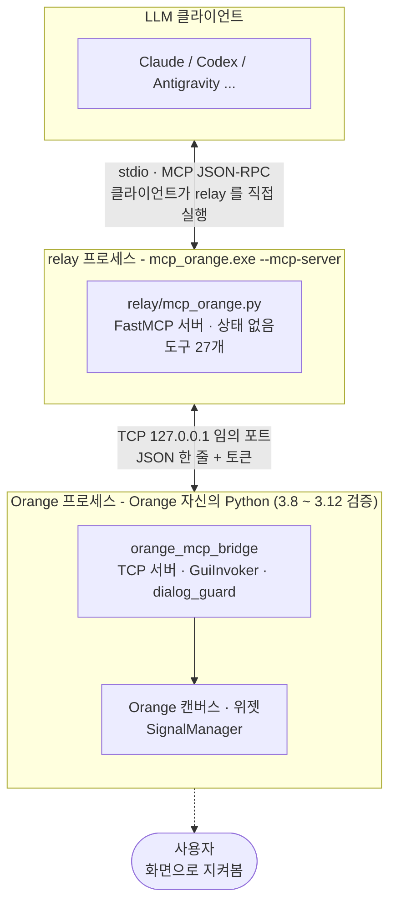
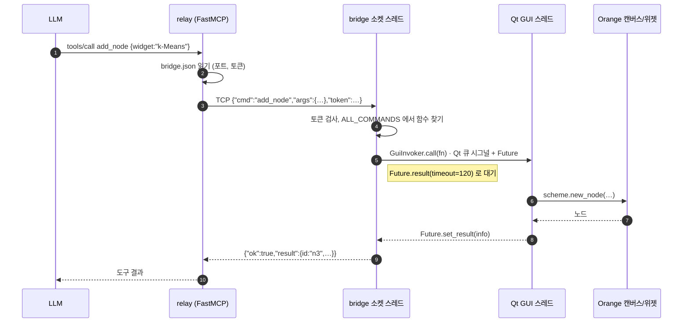

# mcp_orange 아키텍처

LLM(AI)이 MCP 를 통해 **살아 있는 Orange 3 캔버스**를 조작하는 구조를 설명한다.
Orange 소스는 한 줄도 수정하지 않고, 실행 중인 Orange 프로세스 안에 작은 서버(브리지)를 끼워 넣는 방식이다.

> 전체 구조(1절)와 명령 처리 순서(3절)만 Mermaid 로 그렸고, 나머지는 목록·표·ASCII 로 정리했다.
> Mermaid 는 VS Code(Markdown Preview Mermaid Support 확장), GitHub, Notion 등에서 렌더링된다.

---

## 1. 한눈에 보기



| 구성요소 | 위치 | Python | 하는 일 |
|---|---|---|---|
| **mcp_orange.exe** | `app_main.py` → `mcp_orange_app/` | PyInstaller onefile (`mcp` SDK 내장) | 하나의 프로그램. 인자 없음=설정 마법사, `--mcp-server`=stdio MCP 서버, `--check`/`--register`/… |
| **relay** | `relay/mcp_orange.py`, `relay/bridge_client.py` | exe 안 (개발 모드: `.venv`, `mcp>=1.28,<2`) | MCP 도구 27개를 LLM 에 노출하고 브리지로 전달 |
| **bridge** | `orange_mcp_bridge/` | Orange 자신의 Python (표준 라이브러리 + Qt 만, 3.8 문법) | Orange 안에서 실제 캔버스/위젯을 조작 |
| **app 계층** | `mcp_orange_app/` | 표준 라이브러리 (+ tkinter) | Orange 탐색, 호환성 검사, 브리지 배포/기동, 설정 마법사 |
| **manage** | `mcp_manage/` | 표준 라이브러리 | LLM 클라이언트에 exe 를 등록/해지 (런타임에는 관여 안 함) |

핵심 설계 세 가지:

1. **Python 이 둘이다.** relay 는 `mcp` 패키지가 필요해서 exe(또는 개발용 venv) 안에서, bridge 는 Orange 의 객체를 직접 만져야 하므로 **Orange 자신의 Python** 안에서 돈다. 브리지 소스는 exe 안에 데이터로 들어 있다가 `%LOCALAPPDATA%\mcp_orange\bridge\<해시>\` 로 풀려 거기서 실행된다. 둘은 소켓으로만 통신한다.
2. **relay 는 상태가 없다.** 모든 상태(워크플로, 노드 id 등)는 Orange 프로세스에 있다. 그래서 relay 가 죽거나 여러 클라이언트가 동시에 붙어도 같은 Orange 를 공유한다.
3. **모든 조작은 Qt GUI 스레드에서 실행한다.** Qt 객체는 GUI 스레드 밖에서 만지면 안 되기 때문에, 소켓 스레드가 받은 명령을 GUI 스레드로 넘겨 실행한다.

---

## 2. 연결은 어떻게 이루어지나

### 2.1 LLM 클라이언트 ↔ relay (등록)

LLM 클라이언트는 설정에 적힌 명령으로 relay 를 **자식 프로세스**로 실행하고 stdin/stdout 으로 MCP 를 주고받는다.
이 설정을 넣고 빼는 것이 설정 마법사(`mcp_orange.exe`) 또는 `mcp_orange.exe --register / --unregister` 다.

```json
{ "mcpServers": { "orange3": {
    "command": "C:\\…\\mcp_orange.exe",
    "args":    ["--mcp-server"] } } }
```

개발 모드(소스 체크아웃)에서는 `command` 가 `.venv\Scripts\python.exe`, `args` 가 `relay\mcp_orange.py` 가 된다.

| 클라이언트 | 등록 방법 |
|---|---|
| Claude | `claude mcp add --scope user` |
| Codex / ChatGPT 데스크톱 | `codex mcp add` |
| Claude Desktop | 설정 JSON 직접 수정 (Store 판과 일반 설치판 각각) |
| Antigravity | 설정 JSON 직접 수정 |

* 등록한 이름(`orange3`)이 클라이언트에서 도구 이름 접두사가 된다(예: `mcp__orange3__add_node`).
* relay 의 stdout 은 MCP 프로토콜 전용이다. 코드에서 **stdout 에 print 하지 않는다.**
* 전송 방식은 **stdio 만** 지원한다(`mcp.run()` 기본값). HTTP 는 필요해지면 `--http` 옵션으로 추가할 수 있다. Orange 안에는 MCP 서버를 넣지 않는다.

### 2.2 relay ↔ bridge (발견과 인증)

```
[Orange 시작]
  1. create_main_window 훅에서 start_bridge() 호출
  2. 127.0.0.1 의 임의 포트에 TCP 서버를 열고, 토큰(16바이트 hex)을 새로 만든다
  3. 접속 정보를 파일에 기록
       %LOCALAPPDATA%\mcp_orange\bridge.json  →  {"port": 51234, "token": "…", "pid": 1234}

[요청마다, relay 쪽]
  4. bridge.json 을 읽어 포트와 토큰을 얻는다
  5. 새 TCP 연결을 열고 토큰이 든 요청 한 줄을 보낸다
  6. 브리지가 secrets.compare_digest 로 토큰을 검사하고 처리한 뒤 응답 한 줄을 돌려준다

[Orange 종료]
  7. atexit 에서 pid 가 자기 것인 bridge.json 만 삭제
```

* 서버는 **127.0.0.1 에만** 바인딩한다. 토큰은 Orange 를 시작할 때마다 새로 만든다.
* 비정상 종료로 파일이 남으면 relay 는 "stale discovery file?" 오류를 낸다.
* 파일이 하나뿐이므로 **Orange 인스턴스도 하나**를 가정한다.

### 2.3 프로토콜

한 줄(JSON Lines) 요청/응답이고, **요청마다 새 연결**을 연다(연결을 유지하지 않음).

```jsonc
// 요청
{"id": 1, "token": "…", "cmd": "add_node", "args": {"widget": "k-Means"}}
// 응답
{"id": 1, "ok": true,  "result": { … }}
{"id": 1, "ok": false, "error": "KeyError: unknown widget …", "trace": "…"}
```

타임아웃: 브리지가 GUI 스레드 결과를 기다리는 한도 120초, relay 클라이언트의 소켓 한도 130초.

---

## 3. 명령 하나가 처리되는 과정



### 3.1 스레드 구조

Qt 객체는 GUI 스레드에서만 만져야 한다. 그래서 소켓을 받는 스레드와 실제로 일하는 스레드를 분리하고, `GuiInvoker` 가 둘을 잇는다.

```
Orange 프로세스
├─ 소켓 스레드 (daemon)
│    serve_forever ─ 접속을 받으면 요청마다 핸들러 스레드 생성
│    핸들러: 토큰 검사 → GuiInvoker.call(fn) → Future.result(120초) 대기 → 응답 전송
│
└─ Qt GUI 스레드
     GuiInvoker 슬롯 ← pyqtSignal(fn, Future)   (Qt 큐 연결로 GUI 스레드에서 실행)
     명령 함수 실행 → Future.set_result(...)
     dialog_guard 타이머 (250ms)  ← 오류창 점검
```

* 명령은 GUI 스레드에서 **한 번에 하나씩** 실행된다(직렬).
* 소켓 스레드는 `Future.result(timeout)` 으로 기다리므로, GUI 가 오래 막히면 타임아웃 오류가 난다.

### 3.2 도구 → 명령 대응

relay 의 도구 27개는 대부분 같은 이름의 브리지 명령으로 그대로 전달된다. 예외:

| relay 도구 | 처리 |
|---|---|
| `orange_status` | 브리지 `ping` 호출. 실패하면 `running:false` 로 답함 |
| `click_button` | 브리지 명령 이름은 `click` |
| `launch_orange` | **relay 가 직접** Orange 프로세스를 시작 (4.1 참고) |
| `wait_until_idle` | **relay 가 직접** 0.3초 간격으로 `get_status` 를 폴링 |
| `screenshot` | 브리지가 PNG 를 임시 파일로 저장 → relay 가 이미지로 읽어 LLM 에 반환 |

브리지 쪽 명령 모듈:

| 모듈 | 명령 |
|---|---|
| `commands.py` | `ping` `list_widgets` `list_nodes` `list_links` `add_node` `remove_node` `add_link` `remove_link` `screenshot` (+ 개발용 `debug_exec`) |
| `widget_ops.py` | `inspect_widget` `set_setting` `click` `update_widget` `get_status` `get_output` `select_data` `load_file` `open_workflow` `save_workflow` `clear_workflow` `list_dialogs` `answer_dialog` |
| `widget_docs.py` | `get_widget_help` `get_widget_source` |
| `dialog_guard.py` | `get_errors` `set_auto_dismiss` |

`debug_exec` 는 `ORANGE_MCP_DEBUG=1` 로 Orange 를 띄웠을 때만 동작하고 **relay 에는 노출되지 않는다.**

---

## 4. 동작 방식의 세부

### 4.1 Orange 시작 (`launch_orange`)

```
1. 브리지 ping 이 성공하면 → already_running: true 로 바로 반환
2. 사용할 Orange 결정 (launcher.resolve_target)
     ORANGE_PYTHON > config.json 에 저장된 선택 > exe 옆 Orange 폴더 > 드라이브 스캔
     같은 python.exe(크기·수정시각 동일)를 이미 검사했다면 저장된 판정을 쓰고, 아니면 지금 프로브
     비호환/검사 실패 → 사유와 함께 오류,  미검증(probe_ok) → 기동하되 결과에 warning 포함
3. 브리지 소스를 %LOCALAPPDATA%\mcp_orange\bridge\<해시>\ 로 배포 (이미 있으면 재사용)
4. 프로세스 시작
     Windows : WMI Win32_Process.Create 로 실행  (실패하면 DETACHED_PROCESS 로 대체)
     그 외   : start_new_session 으로 실행
     명령    : <Orange python> -s -B -m orange_mcp_bridge   (cwd = PYTHONPATH = 배포 폴더)
     로그    : %LOCALAPPDATA%\mcp_orange\logs\orange.relay.log
5. 1초 간격으로 ping 을 반복 (기본 120초)
     성공   → already_running: false (+ orange_python, compat) 로 반환
     초과   → 오류 (로그 경로 안내)
```

`-P` 는 Python 3.11+ 전용이라 쓰지 않는다. 대신 배포 폴더에 브리지 패키지만 있으므로 `-m` 이 sys.path 에 cwd 를 넣어도 오염이 없고, Python 3.8 기반 Orange 3.32 에서도 같은 방식으로 뜬다.
WMI 로 띄운 프로세스는 우리 환경변수를 물려받지 못하므로, 필요한 것(`MCP_ORANGE_HOME`, `MCP_ORANGE_SETTINGS_DIR`, `QT_QPA_PLATFORM`, `ORANGE_MCP_DEBUG`)만 명령줄에 `set` 으로 실어 보낸다.

Orange 쪽에서는 `McpOMain`(Orange 의 `OMain` 상속)이 실행된다.

* `show_welcome_screen`: 기본 숨김 (`--welcome` 이면 표시)
* `create_main_window`: 창을 만든 직후 `start_bridge()` 로 TCP 서버, `GuiInvoker`, `dialog_guard` 를 시작하고 `bridge.json` 을 기록
* 브리지 시작이 실패해도 Orange 는 계속 뜬다(로그만 남김).

**WMI 로 프로세스를 만드는 이유:** MCP 클라이언트는 relay 의 프로세스 트리를 Job Object 로 묶어 세션 종료 때 함께 죽인다. 평범한 자식으로 띄우면 AI 세션이 끝날 때 Orange 와 작업 중인 워크플로가 사라진다. WMI 로 만든 프로세스는 그 Job 밖에 있다.

### 4.2 노드/링크 식별자

* `n1`, `n2`… / `l1`, `l2`… 는 브리지가 **객체에 처음 요청될 때 붙이는** 카운터 기반 id 이고(`_mcp_id`), Orange 를 재시작하면 처음부터 다시 매겨진다. 노드 **제목**으로도 찾을 수 있다.
* 위젯은 정식 이름(`Orange.widgets.unsupervised.owkmeans.OWKMeans`)이나 표시 이름(`k-Means`)으로 추가한다. 이름이 겹치면 obsolete 가 아닌 쪽을 우선하고, 그래도 여러 개면 오류로 후보를 알려 준다.

### 4.3 설정 변경은 "사람처럼"

`update_widget` 은 위젯 속성을 `setattr` 하지 않고, 그 설정에 연결된 **실제 Qt 컨트롤**을 조작한다. 그래야 Orange 자신의 콜백이 실행되어 재계산이 일어난다.

설정 이름이 `known_settings` 에 없으면 오류로 알려진 목록을 안내한다. 있으면 `controlled_attributes` 에서 연결된 컨트롤을 찾아 종류별로 처리한다.

| 컨트롤 | 동작 |
|---|---|
| 체크박스 | `setChecked` |
| 스핀 / 슬라이더 | 숫자와 범위를 먼저 검사한 뒤 `setValue` |
| 콤보 | `setCurrentIndex` 후 `activated` 시그널 발생 (Orange 가 이 시그널을 구독) |
| 텍스트 | 숫자형 설정이면 변환 가능한지 먼저 검사 → `setText` + `editingFinished` + `returnPressed` |
| 라디오 | 해당 버튼 `click` |
| 리스트 | `selectionModel` 로 항목 선택 |
| (컨트롤 없음) | `setattr` 로 대체. 응답의 `via` 에 "callbacks NOT triggered" 로 표시 |

잘못된 값(숫자칸에 문자, 범위 밖)은 컨트롤에 넣기 전에 거부한다.

### 4.4 결과 읽기

* `get_output`: SignalManager 에 저장된 노드의 마지막 출력값을 읽어 `Table` 이면 행 수·컬럼·앞 N행으로 요약한다.
* `screenshot`: `QWidget.grab()` → PNG. 캔버스 전체 또는 특정 위젯 창.
* `inspect_widget`: 설정 목록(이름, 값, 컨트롤 종류와 선택지/범위), 버튼, 메시지(Error/Warning/Information), busy 상태.
* `wait_until_idle`: 모든 노드가 `blocking/running/pending/signals-queued` 가 아닐 때까지 기다린다.

### 4.5 오류창 자동 처리 (`dialog_guard`)

Orange 의 "Unexpected Error" 같은 **모달 창이 뜨면 GUI 가 멈춰** AI 가 조작할 수 없게 된다. 그래서 GUI 스레드 타이머(250ms)가 다음을 반복한다.

1. `auto_dismiss` 가 꺼져 있으면 아무것도 하지 않는다.
2. 캔버스 창을 제외한, 보이는 최상위 `QDialog` 를 훑는다.
3. 오류 창인지 판정한다: 제목에 `error`, 클래스가 `ErrorReporting`, 또는 `QMessageBox` 의 Critical 아이콘.
4. 위젯명, 예외, traceback 을 수집해 기록한다(최대 100건, `get_errors` 로 조회).
5. 안전한 버튼으로 닫는다: `Don't Send` → `Cancel` → `Close` → `No` → `OK` …

* 전송 계열 버튼은 **절대 누르지 않는다.** 오류 리포트는 제출되지 않는다.
* 응답에 `new_errors` 가 있으면 AI 가 `get_errors` 로 원인을 읽는다.
* 일반 메시지 박스는 자동으로 닫지 않고 `list_dialogs` / `answer_dialog` 로 직접 답한다(`set_auto_dismiss(all_message_boxes=true)` 로 바꿀 수 있음).

### 4.6 개인정보 보호

`recent_*` 설정(파일 이력)은 개인 경로가 들어 있어 값 대신 "N entries hidden" 으로 표시한다.

---

## 5. 전형적인 시나리오

```
LLM  orange_status                  → running: false
LLM  launch_orange                  → Orange 기동, bridge.json 기록
LLM  list_widgets("file")           → File 위젯 확인
LLM  add_node("File")               → n1
LLM  load_file(n1, "iris")          → 데이터 로드
LLM  add_node("k-Means")            → n2
LLM  add_link(n1, n2)
LLM  wait_until_idle                → relay 가 0.3초마다 get_status 폴링, 끝나면 idle: true
LLM  inspect_widget(n2)             → 설정 목록 확인
LLM  update_widget(n2, {"k": 3})    → 실제 컨트롤로 변경, Orange 가 재계산
LLM  get_output(n2) / screenshot(n2)→ 결과 표 / PNG
LLM  save_workflow("x.ows")
```

사용자는 그동안 Orange 창에서 노드가 생기고 연결되는 과정을 그대로 본다. AI 세션이 끝나도 Orange 는 계속 실행된다.

---

## 6. 설계상의 제약과 주의점

| 항목 | 내용 |
|---|---|
| 전송 방식 | LLM ↔ relay 는 stdio 만 지원. HTTP 는 미구현(필요 시 relay 에 옵션 추가) |
| 단일 인스턴스 | `bridge.json` 이 하나라 Orange 도 한 개만 제어 가능 |
| 단일 캔버스 창 | `_window()` 가 활성/보이는 `CanvasMainWindow` 하나를 고름 |
| GUI 스레드 직렬 실행 | 명령은 한 번에 하나씩 실행. 위젯의 긴 계산(모달 대기 포함) 중에는 응답이 늦어져 120초 타임아웃이 날 수 있음 |
| 로컬 보안 | 127.0.0.1 + 임의 토큰이지만, 같은 사용자 계정의 프로세스는 `bridge.json` 을 읽을 수 있음 → 같은 계정 안에서는 신뢰 경계가 없음 |
| Orange 내부 의존 | `get_output`(SignalManager 비공개 속성), 컨트롤↔설정 매핑 등은 Orange 버전 영향을 받음 → `Orange_업그레이드시_mcp_수정포인트.md` 참고 |
| Windows 전용 부분 | WMI 기동, 등록 도구의 설정 경로, 드라이브 스캔 |
| 헤드리스 Qt5 | Orange 3.32(Qt 5.12)는 offscreen/minimal 플랫폼에서 `QMessageBox` 를 띄우면 프로세스가 죽는다(브리지와 무관). 일반 창 모드에서는 정상. 정밀 검사(`--deep`)는 대화상자를 띄우지 않으므로 영향 없음 |
| 포터블 Orange 의 설정 위치 | 포터블 Orange 는 `etc\orangerc.conf` 때문에 위젯 기본값/캔버스 설정을 **설치 폴더 안**(`Orange\config`)에 저장한다. 검사·테스트는 `MCP_ORANGE_SETTINGS_DIR` 로 이를 임시 폴더로 돌린다(브리지가 Orange 의 경로 조회 함수만 바꿔 끼움) |
| onefile 시작 지연 | exe 는 실행할 때마다 압축을 풀어 초기화 응답이 약 1.7초(개발 모드 1.0초). 서명 없는 새 exe 는 Defender/SmartScreen 의 첫 검사로 처음 몇 번이 훨씬 느릴 수 있음 |

---

## 7. Orange 탐색과 호환성 검사

`mcp_orange_app/` 이 담당한다. 설정 마법사, `--check`, `--register`, `launch_orange` 가 같은 코드를 쓴다.

```
discovery   후보 python.exe 를 찾는다 (읽기만 함)
   ORANGE_PYTHON → config.json → exe 옆 Orange\ → 드라이브 루트/사용자 폴더/Program Files 의 'orange' 폴더(깊이 2) → conda envs
probe       후보의 python 을 `-s -B -c` + offscreen 으로 실행해 점검 (후보 폴더에 아무것도 쓰지 않음)
   버전: Orange3 / orange-canvas-core / orange-widget-base / Qt
   필수(fatal): OMain 훅 4개, CanvasMainWindow 3개 메서드, widget_for_node, SignalManager 비공개 속성,
                gui.controlled_attributes, SettingsHandler.known_settings, 브리지 소스가 그 Python 문법으로 컴파일되는지
   선택(warn) : ErrorReporting, 산점도 선택 API, OWFile 도우미  → 없으면 해당 기능만 제한
compat      판정
   verified      검증된 조합(3.32.0, 3.40.0)과 정확히 일치 + 필수 항목 통과
   probe_ok      목록에 없는 버전이지만 필수 항목은 통과 (사용 가능, 경고)
   incompatible  필수 항목 실패 / Orange 가 아님
   error         검사 자체를 못 함
smoke       (선택, --check --deep) 임시 데이터 폴더 + offscreen 으로 Orange 를 실제로 띄워 시나리오 22단계 실행
```

프로브는 "필요한 내부 심볼이 있는가"만 본다. 동작이 바뀐 경우는 못 잡으므로 `verified` 는 실제로 `tests\matrix.py`
(전체 회귀)를 통과시켜 본 조합에만 붙인다 (`compat.VERIFIED_COMBOS`). 새 버전을 목록에 추가하려면 먼저 matrix 를 돌린다.

---

## 8. 파일 지도

```
mcp_orange/
├── app_main.py                    mcp_orange.exe 의 진입 스크립트
├── mcp_orange_app/                앱 계층 (표준 라이브러리 + tkinter)
│   ├── main.py · cli.py           모드 분기, --check/--register/--unregister/--status
│   ├── discovery.py               Orange 탐색
│   ├── probe.py · compat.py       호환성 프로브와 판정
│   ├── launcher.py                대상 선택, 브리지 배포, Orange 기동(WMI)
│   ├── smoke.py                   정밀 검사 (offscreen 실행 + 시나리오)
│   ├── wizard.py                  설정 마법사 GUI
│   ├── housekeeping.py            강제 종료로 남은 _MEI 임시 폴더 정리
│   └── paths.py · config.py       경로 규칙, config.json
├── build/                         PyInstaller spec + build_exe.ps1  → dist\mcp_orange.exe
│
├── relay/                         MCP 서버 (stdio)
│   ├── mcp_orange.py              도구 27개 정의, launch_orange, wait_until_idle
│   ├── bridge_client.py           bridge.json 읽기 + 소켓 호출 (표준 라이브러리)
│   └── requirements.txt           mcp>=1.28,<2
│
├── orange_mcp_bridge/             Orange 안에서 실행 - Orange Python (표준 라이브러리 + Qt)
│   ├── __main__.py                McpOMain: Orange 시작 + 브리지 시작 훅 (+ 설정 격리)
│   ├── server.py                  TCP 서버, 토큰 검사, GuiInvoker, bridge.json 기록
│   ├── commands.py                그래프 편집, 위젯 카탈로그, 스크린샷
│   ├── widget_ops.py              위젯 조사/설정/클릭/선택/출력, 다이얼로그, 워크플로 파일
│   ├── widget_docs.py             위젯 도움말/소스 조회
│   └── dialog_guard.py            오류창 자동 닫기와 기록
│
├── mcp_manage/                    LLM 클라이언트 등록/해지 (런타임에는 관여 안 함)
│   ├── clients.py                 클라이언트별 설정 읽기/쓰기 핵심 로직 (ServerSpec = 명령 + 인자)
│   ├── cli.py                     명령줄 (status / install / uninstall)
│   └── gui.py                     tkinter 패널 (마법사에 포함) + 단독 창
├── manage.py · manage.cmd         개발 모드용 등록 도구 진입점
│
├── run_orange.ps1                 개발용 Orange 수동 실행
├── scripts/restart.ps1            개발용 재시작 (-Debug)
├── tests/                         회귀 테스트: run_all.ps1(개발), matrix.py(Orange 버전별), test_app.py 등
│
├── README.md
├── 아키텍처_구조.md                (이 문서)
└── Orange_업그레이드시_mcp_수정포인트.md
```

관련 문서: [README.md](README.md) · [Orange_업그레이드시_mcp_수정포인트.md](Orange_업그레이드시_mcp_수정포인트.md)
